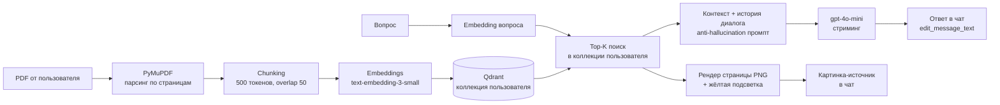

# 📄 Telegram RAG-бот по документам

Telegram-бот, который отвечает на вопросы по загруженным пользователями PDF-документам по архитектуре RAG (Retrieval-Augmented Generation): документ разбирается на чанки, векторизуется и складывается в Qdrant, при вопросе ищутся релевантные фрагменты, и LLM формирует ответ **строго по контексту** с указанием источника («документ.pdf, стр. 12») и картинкой страницы с подсветкой найденного абзаца. Проект демонстрирует работу с LLM, векторными БД и Docker на чистом Python — без LangChain/LlamaIndex: aiogram 3, Qdrant, PostgreSQL (+alembic), PyMuPDF, OpenAI API (`gpt-4o-mini` / `text-embedding-3-small`).

## Демонстрация


> GIF-запись (30 сек): прикрепляем PDF → спрашиваем «какой SLA?» → ответ печатается постепенно → приходит скриншот страницы с жёлтой подсветкой абзаца-источника. Записать: [ScreenToGif](https://www.screentogif.com/) → сохранить в `docs/demo.gif`.

## Схема пайплайна



## Как запустить

Нужны: Docker + Docker Compose, токен бота от [@BotFather](https://t.me/BotFather), API-ключ [OpenAI](https://platform.openai.com/api-keys).

```bash
git clone <repo> && cd ai-project
cp .env.example .env
# впишите в .env: BOT_TOKEN и OPENAI_API_KEY

docker compose up -d --build
```

Одна команда поднимает всё: PostgreSQL, Qdrant и бота (контейнер бота сам накатывает миграции alembic при старте). Логи: `docker compose logs -f bot`. Останов: `docker compose down` (данные сохраняются в volumes).

Использование: `/start` → прикрепить PDF → задать вопрос → `/reset` для очистки контекста диалога.

<details>
<summary><b>Запуск без Docker (разработка)</b></summary>

```bash
python -m venv .venv && . .venv/bin/activate  # Windows: .venv\Scripts\activate
pip install -e ".[dev]"
docker compose up -d postgres qdrant          # только инфраструктура
# в .env: POSTGRES_HOST=localhost, QDRANT_URL=http://localhost:6333
alembic upgrade head
python -m src.main
```
</details>

## Тесты и оценка качества

```bash
pip install -e ".[dev]"
pytest                                    # 14 unit-тестов: chunker, parser, подсветка, источники

docker compose up -d postgres qdrant
python eval/run_eval.py                   # Accuracy на датасете из 14 вопросов
```

Eval-датасет: вымышленный договор с конкретными фактами (`eval/make_sample_pdf.py` генерирует `eval/samples/sample.pdf`), `eval/questions.jsonl` — пары вопрос-эталонный ответ. Скрипт индексирует PDF в изолированную eval-коллекцию, прогоняет вопросы и считает Accuracy по совпадению ожидаемого ответа.

**Accuracy: `python eval/run_eval.py` → результат** *(например: «Accuracy: 93% (13/14) на тестовом датасете»)*

## Архитектура

Слои без «божественных» функций: хендлеры только принимают/отправляют сообщения, вся логика — в сервисах, внешние системы — в клиентах.

| Слой | Пакет | Ответственность |
|---|---|---|
| bot | `src/bot` | aiogram-хендлеры, троттлинг `edit_message_text` |
| services | `src/services` | оркестрация: ingestion, QA, документы, история |
| ingestion / retrieval / llm | `src/ingestion`, `src/retrieval`, `src/llm` | пайплайн PDF→чанки→векторы, поиск в Qdrant, генерация |
| core | `src/core` | конфиг (pydantic-settings), БД, логирование |

Изоляция данных: **один пользователь — одна коллекция Qdrant** (`user_<telegram_id>`). PostgreSQL хранит пользователей, статусы обработки файлов и историю диалога (контекст для LLM, чистится `/reset`).

## Проблемы и решения

- **Лимит Telegram на `edit_message_text`** (~1 правка/сек на чат): стриминг-редактор шлёт промежуточные правки не чаще раза в 1.2 с, финальная — всегда; «message is not modified» гасится, ответы длиннее 4096 символов обрезаются с сохранением начала и конца.
- **В образе Qdrant нет curl/wget** для healthcheck: проверка через bash `/dev/tcp` — обычная правка TCP-сокета без утилит.
- **Токены для чанкинга**: tiktoken требует скачивания файлов кодировок; при их недоступности счётчик откатывается на приближение (~3 символа/токен для русского) — пайплайн не ломается в офлайн-сборках.
- **Кириллица в подсветке**: текст из `get_text` не всегда совпадает с поисковым `search_for` (переносы строк); подсветка ищет сначала полный фрагмент, затем по первым словам, а неудача подсветки не ломает ответ — логируется warning.
- **Сканы без текстового слоя**: PyMuPDF возвращает пустой текст → документ помечается `failed` с человекочитаемой причиной (OCR — вне MVP).
- **Фоновая обработка PDF**: ингестия идёт в `asyncio.create_task`, статус-сообщение редактируется по готовности — чат не блокируется на больших файлах.

## Стоимость запроса

Модель ответа — `gpt-4o-mini` ($0.15/1M входных, $0.60/1M выходных токенов), эмбеддинги — `text-embedding-3-small` ($0.02/1M):

| Статья | Токены | Стоимость |
|---|---|---|
| Эмбеддинг вопроса | ~30 | ~$0.0000006 |
| Контекст (top-5 × 500) + промпт | ~2 600 входных | ~$0.0004 |
| Ответ LLM | ~300 выходных | ~$0.0002 |
| **Итого за вопрос** | | **≈ $0.0006 (0.06 цента)** |

Ингестия PDF (20 стр. ≈ 10K токенов) ≈ $0.0002. Тысяча вопросов ≈ **$0.60**.

## Out of Scope (MVP)

Авторизация по телефону/email, биллинг, форматы кроме PDF, cross-encoder реранкеры.
